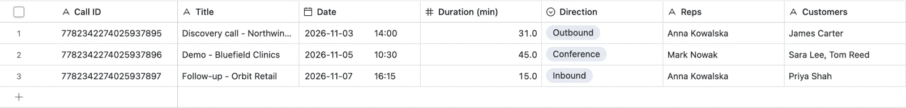

# Gong → Airtable Call Sync

Pulls sales call data from **Gong** (title, date, duration, reps, customers, AI summary, full transcript) and writes it into an **Airtable** table: one row per call.

Built to replace manual copy-paste: a sync that takes hours by hand runs in seconds, and running it again never creates duplicates.




## Features

- **Read-only Gong access**: uses only `POST /v2/calls/extensive` and `POST /v2/calls/transcript`.
- **No duplicates**: Airtable upsert matched on `Call ID`, so re-runs update rows instead of adding new ones.
- **Readable transcripts**: `Speaker: text` lines, trimmed to fit Airtable's long-text limit.
- **Handles API limits**: pagination (cursors), batches of 10, retries on HTTP 429.
- **Test batch first**: `--limit 10` syncs only the first 10 calls for review.
- **Safe by default**: secrets only in environment variables / `.env` (gitignored), never in code.
- **Mock mode**: sample data in the same shape as the Gong API, so the demo runs without any keys.
- **No dependencies**: Python 3.9+ standard library only.

## Quick start (no API keys)

```bash
python3 sync.py --mock --dry-run
```

Writes the sample calls to `output.csv`. You can import that file into Airtable to see the result.

## Run with real APIs

1. Copy `.env.example` to `.env` and fill it in:
   - **Gong**: an admin creates an Access Key + Secret in *Company Settings → Ecosystem → API*.
   - **Airtable**: a personal access token limited to one base, with `data.records:read`, `data.records:write` and, for `--setup`, `schema.bases:read` and `schema.bases:write`.
2. Run once with `--setup` to create the table (default name `Calls`) automatically, or create it by hand with these fields:

| Field | Airtable type |
|---|---|
| Call ID | Single line text |
| Title | Single line text |
| Date | Date (with time) |
| Duration (min) | Number (1 decimal) |
| Direction | Single select |
| Reps | Single line text |
| Customers | Single line text |
| Customer Emails | Long text |
| Summary | Long text |
| Transcript | Long text |
| Gong URL | URL |

3. Run:

```bash
python3 sync.py --mock --setup                          # create table + load sample calls
python3 sync.py --from 2026-11-01 --to 2026-11-08 --limit 10   # real test batch
python3 sync.py --from 2026-11-01 --to 2026-11-08              # full range
```

| Option | Meaning |
|---|---|
| `--mock` | use sample data instead of the Gong API |
| `--from`, `--to` | date range, `YYYY-MM-DD` (default: last 7 days) |
| `--limit N` | only the first N calls |
| `--no-transcripts` | skip transcripts (faster) |
| `--dry-run` | write to CSV instead of Airtable |
| `--setup` | create the Airtable table if it does not exist |

## Tests

```bash
python3 -m unittest discover -s tests -v
```

## Project layout

```
sync.py             CLI: fetch -> transform -> upsert
gong_client.py      Gong API client + mock client
airtable_client.py  Airtable upsert client
transform.py        Gong call -> flat Airtable row
sample_data/        mock Gong API responses
tests/              unit tests
```

Sample data is fictional.
